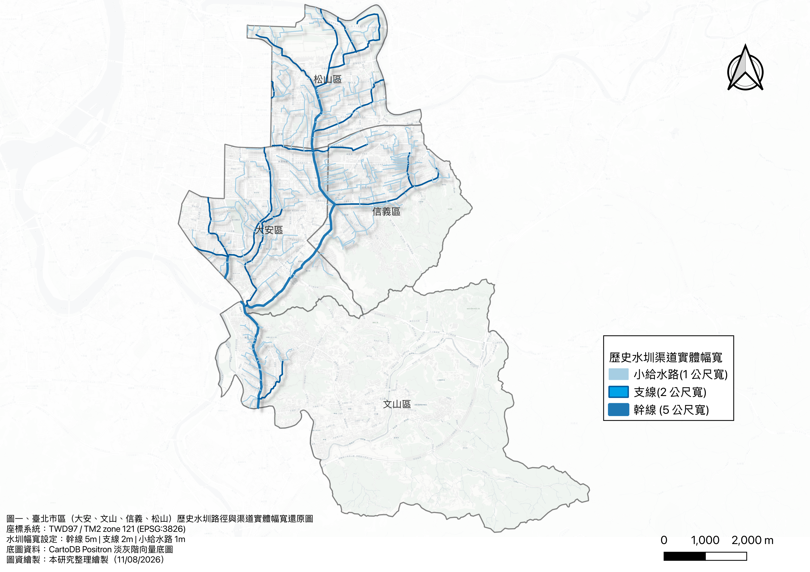
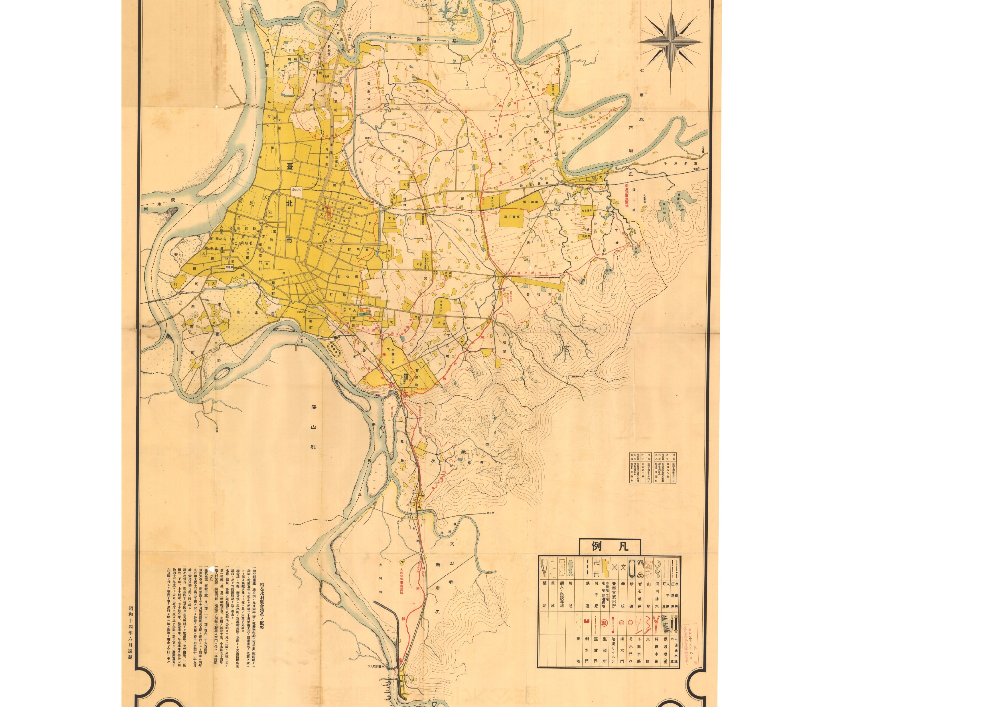
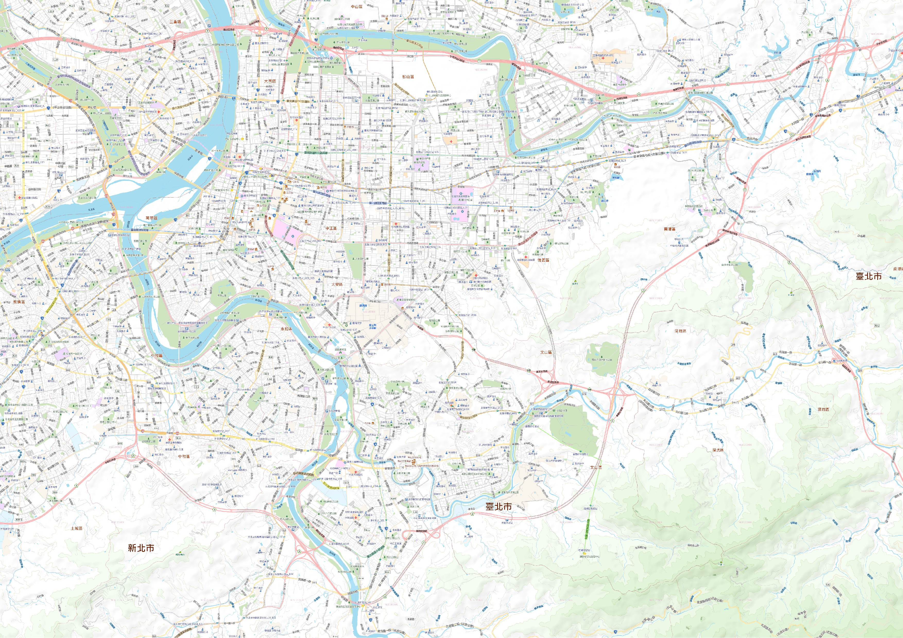

# Chapter 3 — Methods and Reconstruction of Spatial Data

> **“By overlaying historical maps and present-day flood-susceptibility locations in a GIS, the concealed pattern of the former water network can be made visible again.”**

---

### 3.1 Data Sources and Spatial Reconstruction

The study focuses on four districts in central and southern Taipei—Da’an, Songshan, Xinyi, and Wenshan—and applies geometric correction and vectorization to the source data.

1. **Mapped flood-area polygons and derived centroids (650 mm of rainfall in 24 hours)**  
   Polygon data were obtained from Taiwan’s Water Resources Agency and the Taipei City Government. The polygons represent areas mapped as flood-prone under the specified rainfall scenario or areas previously recorded as inundated. Following geometric correction, the geometric centroid of each polygon was calculated, producing **3,022 flood-area centroid points** for point-based analysis. These centroids are analytical representations of mapped areas; they are not 3,022 independently observed flood incidents.
2. **Historic-waterway vector layer**  
   Culverted historic waterway corridors were redrawn and reconstructed from historical sources, including the *Taiwan Fortress Map* (臺灣堡圖) from the Japanese colonial period and the 1939 *Map of the Liugong Irrigation Association District* (瑠公圳水利組合區域圖). Channel widths were represented as 5 m for main canals, 2 m for branches, and 1 m for minor distribution channels.

---

### 3.2 Comparing Historic Waterways with the Modern City

#### Reconstructed routes and physical widths of historic irrigation canals

*Figure 3-1. Reconstructed routes and physical channel widths of historic irrigation canals in Da’an, Wenshan, Xinyi, and Songshan districts, Taipei.*

#### Interactive comparison of historic and modern maps

*Drag the slider to compare the 1939 Liugong Irrigation Association map with a map of present-day Taipei.*

  
  

    
  

  <input type="range" min="0" max="100" value="50" id="compare-range-input" aria-label="Compare the 1939 and present-day maps" style="position: absolute; top: 0; left: 0; width: 100%; height: 100%; opacity: 0; z-index: 10; cursor: ew-resize; margin: 0;" />
  

    
◄►

  

  
1939 Liugong irrigation map

  
Present-day Taipei

---

### 3.3 Spatial Analysis

#### 1. Micro-scale distance bands and standardized density

The shortest geometric distance from each flood-area centroid to the nearest historic waterway was calculated and divided into five classes reflecting the scale of Taipei’s streets and urban blocks. To account for unequal distance-band widths, the analysis reports a **band-width-normalized point count**: the number of centroids divided by the width of each distance band. This exploratory measure adjusts for unequal radial widths but is not an areal density. A conventional spatial-density comparison would divide the count in each non-overlapping band by that band’s land area (for example, centroids per km²).

#### 2. Plain-constrained Monte Carlo simulation

Hillslopes with gradients greater than 30% were excluded because they are less susceptible to standing water and generally farther from the historic canals. Within the remaining low-lying plain, 3,022 points were placed at random in each of 1,000 simulations. The resulting expected median distances were compared with the observed median distance of 125.72 m to estimate a spatial significance value.

#### 3. Overlay analysis

Risk buffers of 15 m, 30 m, and 50 m around the historic waterways were dissolved and overlaid with the flood-area centroids. The analysis then compared the number and proportion of points inside and outside the buffered corridors.
